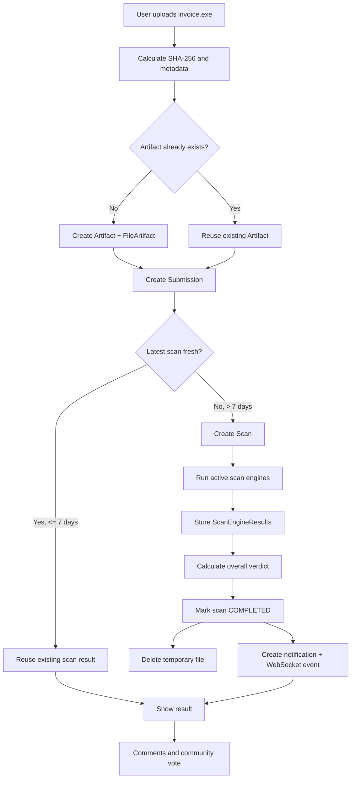

# File Scan Flow — Complete Example

> You sign in, upload `invoice.exe`, receive scan results, and discuss the file.

This example explains how the main database tables work together during a real request.

## 1. Identify the user

The authentication layer identifies the account making the request.

Example:

```text
users.id = user-7
```

Authentication happens before the upload workflow continues.

## 2. Calculate the file identity

The backend calculates:

```text
SHA-256
SHA-1
MD5
size
MIME type
```

SHA-256 is the main deduplication key because `file_artifacts.sha256` is unique.

## 3. Look for an existing artifact

The backend searches `file_artifacts` using the SHA-256.

If the hash already exists, the existing `Artifact` is reused.

If it does not exist, the backend creates:

```text
artifacts
    +
file_artifacts
```

Example:

```text
artifacts
id = artifact-42
type = FILE

file_artifacts
artifact_id = artifact-42
sha256 = <calculated SHA-256>
size = <file size>
mime_type = application/x-msdownload
```

The filename is not used as the identity because two files can have different names while containing exactly the same bytes.

## 4. Record the submission

A new `submissions` row is created for every upload, even when the artifact already exists.

Example:

```text
submission-101
artifact_id = artifact-42
user_id = user-7
visibility = PUBLIC
original_filename = invoice.exe
source = WEB
```

This is why `Artifact` and `Submission` are separate:

- `Artifact` answers: **What file is this?**
- `Submission` answers: **Who submitted it, when, and with what visibility?**

For an anonymous submission, `user_id = NULL`.

## 5. Decide whether a new scan is required

The backend checks the latest completed scan for the artifact.

Current project policy:

```text
latest result <= 7 days old
    -> reuse existing result
    -> allow a manual rescan

latest result > 7 days old
    -> automatically start a new scan
```

The `scans.stale_at` field supports this check.

## 6. Create and run the scan

If a new scan is needed, the backend creates a `scans` row.

Example:

```text
scan-500
artifact_id = artifact-42
submission_id = submission-101
status = QUEUED
reason = INITIAL
overall_verdict = UNKNOWN
```

When processing starts:

```text
QUEUED -> RUNNING
```

The backend then coordinates all configured active `scan_engines`.

## 7. Store each engine result

Every external engine response becomes one `scan_engine_results` row.

Example:

| Engine | Verdict | Detection |
|---|---|---|
| Engine A | MALICIOUS | Trojan.Generic |
| Engine B | HARMLESS | — |
| Engine C | SUSPICIOUS | Suspicious.PE |

The pair `scan_id + engine_id` is unique, so the same engine cannot create duplicate results for the same scan.

## 8. Finish the scan

When the configured engines have responded, the backend calculates the overall verdict and updates the scan.

Example:

```text
status = COMPLETED
overall_verdict = MALICIOUS
completed_at = now
stale_at = completed_at + 7 days
```

Old scans are kept, so rescans create history instead of overwriting previous results.

## 9. Delete the temporary binary

The uploaded binary is temporary.

After external analysis finishes, it should be deleted immediately, with an absolute maximum retention of 24 hours.

The submission tracks this with:

```text
binary_delete_deadline
binary_deleted_at
```

The binary is deleted, but the hashes, metadata and scan results remain.

## 10. Notify the user

If appropriate, the backend creates a `notifications` row.

Example:

```text
type = SCAN_COMPLETED
user_id = user-7
artifact_id = artifact-42
```

A WebSocket event can then update the frontend in real time.

The database stores the notification state; WebSocket is the delivery mechanism.

## 11. Store community activity

For a public artifact, a comment creates a `comments` row:

```text
artifact_id = artifact-42
user_id = user-7
body = "This executable contacts an unknown domain."
parent_id = NULL
```

Replies use the same table and set `parent_id` to the parent comment.

A community verdict creates or updates a `community_votes` row:

```text
artifact_id = artifact-42
user_id = user-7
verdict = MALICIOUS
```

Because `artifact_id + user_id` is the primary key, one user can only have one active vote per artifact.

## 12. Respect privacy

If the submission is `PRIVATE`:

- it does not appear in public search;
- it does not appear in public community discussion;
- it is not exposed through the public API;
- admin analytics may count it only in aggregate.

If the same SHA-256 already has a public result, that public result can still be reused without exposing the private submission.

## End-to-end flow



## Main idea to remember

```text
User
  |
Submission
  |
Artifact
  |
Scan
  |
ScanEngineResult
```

The separation is deliberate:

- one artifact can be submitted many times;
- one artifact can have many scans over time;
- one scan can have many engine results;
- comments and votes belong to the artifact, not to one specific upload.
